<picture>
  <source media="(prefers-color-scheme: dark)" srcset="assets/hero-dark.svg">
  <source media="(prefers-color-scheme: light)" srcset="assets/hero-light.svg">
  
</picture>

 

<picture>
  <source media="(prefers-color-scheme: dark)" srcset="assets/h-projects-dark.svg">
  <source media="(prefers-color-scheme: light)" srcset="assets/h-projects-light.svg">
  
</picture>

**[The Honour 1](https://github.com/vedantmandanka47/Thehonour1)** &nbsp;`concept`  
A narrative-driven dark-fantasy action RPG about honour, sacrifice, choices and consequences.

**[CSI Website](https://github.com/vedantmandanka47/CSI)** &nbsp;`full-stack`  
The official digital platform for the CSI GCET Student Branch, built around its activities, events and community. <!-- add link: https://github.com/YOUR_USERNAME/REPO -->

**[Mystery Investigation Game](https://github.com/vedantmandanka47/Mystry-Investigation-Game)** &nbsp;`web game`  
An interactive mystery-solving game. The frontend is HTML, CSS and JavaScript; the backend is Python with Django and Flask. <!-- add link -->

**[Mini GitHub: Version Tree](https://github.com/vedantmandanka47/MiniGithub)** &nbsp;`full-stack`  
A full-stack project exploring version control and a visual way to read the history of a codebase. <!-- add link -->

**[Resume IQ](https://github.com/vedantmandanka47/ResumeIQ)** &nbsp;`agentic AI`  
An agentic AI application that builds tailored resumes, career roadmaps and guided workflows. <!-- add link -->

 

<picture>
  <source media="(prefers-color-scheme: dark)" srcset="assets/h-stack-dark.svg">
  <source media="(prefers-color-scheme: light)" srcset="assets/h-stack-light.svg">
  
</picture>

<picture>
  <source media="(prefers-color-scheme: dark)" srcset="assets/stack-dark.svg">
  <source media="(prefers-color-scheme: light)" srcset="assets/stack-light.svg">
  
</picture>

 

<picture>
  <source media="(prefers-color-scheme: dark)" srcset="assets/h-creative-dark.svg">
  <source media="(prefers-color-scheme: light)" srcset="assets/h-creative-light.svg">
  
</picture>

I design and edit video. My main style is **minimalism and aesthetic**: clean composition, quiet motion, and nothing that doesn’t earn its place.

 

<picture>
  <source media="(prefers-color-scheme: dark)" srcset="assets/h-grid-dark.svg">
  <source media="(prefers-color-scheme: light)" srcset="assets/h-grid-light.svg">
  
</picture>

<picture>
  <source media="(prefers-color-scheme: dark)" srcset="assets/pacman-dark.svg">
  <source media="(prefers-color-scheme: light)" srcset="assets/pacman-light.svg">
  
</picture>

 

<picture>
  <source media="(prefers-color-scheme: dark)" srcset="assets/h-writer-dark.svg">
  <source media="(prefers-color-scheme: light)" srcset="assets/h-writer-light.svg">
  
</picture>

<picture>
  <source media="(prefers-color-scheme: dark)" srcset="assets/tide-dark.svg">
  <source media="(prefers-color-scheme: light)" srcset="assets/tide-light.svg">
  
</picture>

<i>When the Sea's tide come by, 
That's when we go high,  
with our pride; 
but the tide doesnt stay high, 
it have to go down to sea, 
But you must not desea.</i>

just a bit of wisdom from my side - shuyona·

